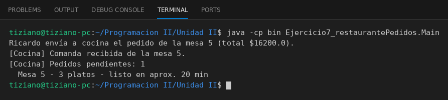

# Cocina

Programación II - Unidad 2 - Ejercicio 7

## Consigna
Un Mozo envía a la Cocina un objeto Pedido con varios platos.

## Lógica
- `Plato` (nombre, precio, tiempo de preparación) y `Pedido` (número de mesa y lista de platos, con total y tiempo estimado = el plato más lento).
- `Cocina.recibirComanda(Pedido)`: agrega el pedido a una cola (`Queue`) de pendientes.
- `Mozo.enviarPedidoACocina(pedido, cocina)`: rechaza pedidos vacíos y si no, gestiona el envío.
- `Main`: arma un pedido de tres platos, lo envía e imprime el estado de la cocina.

## Ejecución

